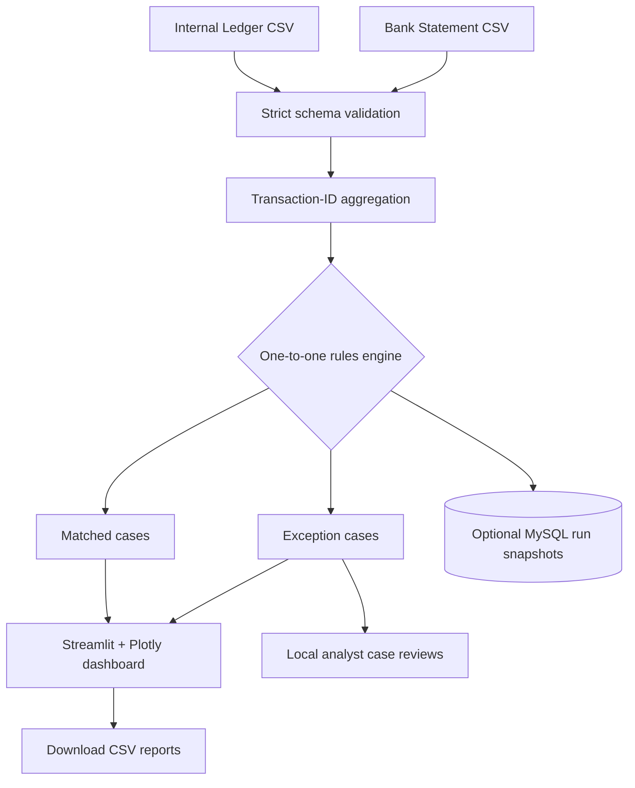

# FinSight — Financial Operations & Reconciliation Dashboard

**Python · Pandas · MySQL · Streamlit · Plotly · Pytest**

FinSight is an end-to-end financial reconciliation platform that matches an internal payments ledger against a bank statement, automatically detects operational breaks, surfaces control metrics, and provides an analyst exception-review workflow.

> **Data safety:** All bundled transactions, counterparties, transaction IDs, and amounts are synthetically generated. FinSight is a demonstrator — not production banking or accounting software.

---

## Demo results (seed 42 · 5,000 base transactions)

| KPI | Value |
|-----|------:|
| Base ledger transactions | 5,000 |
| Ledger rows (incl. duplicates) | 5,020 |
| Bank rows | 4,990 |
| Unique reconciliation cases | 5,060 |
| Matched cases | 4,720 |
| Exceptions | 340 |
| Ledger match rate | **94.40%** |

The demo intentionally seeds **missing bank entries, unexpected bank entries, amount mismatches, currency mismatches, delayed postings, and duplicate IDs**. All values are reproducible with `--seed 42`.

---

## Features

- **Pandas reconciliation** — exact transaction-ID join; signed integer-pence matching; currency check; configurable calendar-day posting window; deterministic rule precedence.
- **Duplicate protection** — repeated transaction IDs on either side are isolated *before* comparing values, preventing accidental many-to-many matches.
- **Quality validation** — required columns, dates, three-letter currency codes, integer minor-unit amounts, unique bank row IDs, and missing-identifier checks.
- **Streamlit dashboard** — finance KPIs, interactive Plotly plots, filters, CSV uploads/exports, and an exception investigation queue.
- **Analyst case workflow** — assign `Open` / `Investigating` / `Resolved` review status and free-text notes without altering the underlying reconciliation result.
- **Optional MySQL** — persist each reconciliation run as an immutable historical snapshot with source entries and resulting cases; run prepared SQL queries in MySQL Workbench.
- **Automated tests & CI** — pytest coverage of mismatches, duplicate traps, strict validation, deterministic data generation, and local case-review updates.

---

## Architecture



---

## Quick start

**Requirements:** Python 3.11–3.13. MySQL 8.0+ is optional.

```bash
# 1. Clone the repository
git clone https://github.com/YOUR-USERNAME/finsight.git
cd finsight

# 2. Create an isolated virtual environment
python -m venv .venv

# Windows
.venv\Scripts\activate

# macOS / Linux
source .venv/bin/activate

# 3. Install dependencies
pip install -r requirements.txt

# 4. Launch the dashboard
streamlit run app.py
```

The dashboard opens at **http://localhost:8501** automatically.

---

## CLI usage

Generate a fresh synthetic dataset and export reconciliation results:

```bash
# Regenerate CSVs with a fixed seed
python -m finrecon.cli generate --count 5000 --seed 42

# Run reconciliation and export cases
python -m finrecon.cli reconcile

# Change the allowed posting-date tolerance (default: 2 days)
python -m finrecon.cli reconcile --date-tolerance 3
```

Outputs are written to `data/ledger.csv`, `data/bank_statement.csv`, and `outputs/reconciliation_cases.csv`.

---

## Optional MySQL connection

```bash
# 1. Copy the example config and edit your credentials
cp .env.example .env

# 2. Run reconciliation and persist to MySQL
python -m finrecon.cli reconcile --save-mysql
```

FinSight creates a `finsight` database (configurable via `MYSQL_DATABASE`), applies the schema from `sql/schema.sql`, and writes an immutable snapshot of ledger rows, bank rows, and cases. Use **`sql/analysis_queries.sql`** in MySQL Workbench for pre-built finance queries.

> **Nothing is sent to MySQL** unless you click **Save this reconciliation to MySQL** in the dashboard or pass `--save-mysql` on the CLI.

---

## How matching works

One case is produced per distinct transaction ID. All comparisons use signed integer `amount_pence`, not floating-point values.

**Rule precedence (first match wins):**

| Priority | Classification | Rule |
|:--------:|---------------|------|
| 1 | `duplicate_both` | Multiple ledger rows **and** multiple bank rows for the same ID |
| 2 | `duplicate_ledger` | Multiple ledger rows for the same ID |
| 3 | `duplicate_bank` | Multiple bank rows for the same ID |
| 4 | `unexpected_bank` | ID appears only in the bank statement |
| 5 | `missing_bank` | ID appears only in the ledger |
| 6 | `currency_mismatch` | Same ID on both sides but currency codes differ |
| 7 | `amount_mismatch` | Same ID and currency but amounts differ by ≥ 1 pence |
| 8 | `date_mismatch` | Same ID, currency, and amount but date gap exceeds tolerance |
| 9 | `matched` | ID, currency, exact amount, and date all pass |

- `amount_difference_pence` = bank minus ledger (defined for one-to-one, same-currency pairs only).
- `date_lag_days` = posting date minus ledger date; negative values are allowed.
- **Match rate denominator:** unique ledger transaction IDs (not raw row count or bank-only cases).
- **GBP volume KPI:** sum of absolute matched GBP ledger amounts only; other currencies are not mixed.

---

## Project structure

```
finsight/
├── app.py                         # Streamlit user interface
├── finrecon/
│   ├── cli.py                     # Command-line interface
│   ├── io.py                      # Input validation & CSV loading
│   ├── generator.py               # Deterministic synthetic data generation
│   ├── reconciliation.py          # Core matching & exception logic
│   ├── metrics.py                 # KPI definitions
│   ├── reviews.py                 # Local analyst notes & status
│   └── database.py                # Optional MySQL snapshots
├── data/
│   ├── ledger.csv                 # Bundled synthetic internal ledger
│   └── bank_statement.csv         # Bundled synthetic bank statement
├── docs/
│   └── PROJECT_OVERVIEW.md        # Business context & architecture notes
├── sql/
│   ├── schema.sql                 # MySQL tables & indexes
│   └── analysis_queries.sql       # Sample SQL for finance analysts
├── tests/                         # Automated unit tests (pytest)
├── .github/workflows/tests.yml    # CI — Python 3.11, 3.12, 3.13
├── .streamlit/config.toml         # Dashboard theme
├── .env.example                   # Sample DB config (never commit .env)
├── requirements.txt
├── requirements-dev.txt
└── LICENSE
```

---

## Running tests

```bash
pip install -r requirements-dev.txt
python -m pytest -q
```

CI runs on every push and pull request via GitHub Actions. MySQL is **not** required for the unit tests.

---

## CSV input contract

**`ledger.csv`**

| Column | Example | Description |
|--------|---------|-------------|
| `transaction_id` | `TXN-0000001` | Reconciliation key; duplicates are exceptions |
| `transaction_date` | `2026-01-01` | YYYY-MM-DD |
| `amount_pence` | `250000` | Signed minor units (£2,500.00) |
| `currency` | `GBP` | Three-letter ISO currency code |
| `counterparty` | `Northstar Retail Ltd` | Business name |
| `reference` | `INV-34912` | Ledger reference for investigation |

**`bank_statement.csv`**

| Column | Example | Description |
|--------|---------|-------------|
| `bank_entry_id` | `BNK-0000001` | Unique source-bank row identifier |
| `transaction_id` | `TXN-0000001` | Join key; duplicates reveal double postings |
| `posting_date` | `2026-01-02` | YYYY-MM-DD |
| `amount_pence` | `250000` | Signed minor units |
| `currency` | `GBP` | Three-letter ISO currency code |
| `reference` | `INV-34912` | Bank reference for investigation |

You can replace either CSV with your own data provided it matches the column contracts above.

---

## Dashboard walkthrough

| Tab | Description |
|-----|-------------|
| 📊 **Overview** | KPI tiles + Plotly classification, weekly exception trend, and priority breakdown charts |
| 🚩 **Exception Management** | Sortable investigation queue with per-case review form (Open / Investigating / Resolved) |
| 🧾 **Data Explorer** | Raw ledger & bank tables, full reconciliation case table, and CSV downloads |
| 🗄️ **MySQL History** | Save and reload historical run snapshots (requires MySQL + `.env`) |

**Sidebar controls:**
- Upload your own ledger and bank CSVs
- Adjust the allowed date-posting tolerance (0–10 calendar days)
- Filter by reconciliation status and priority
- Search by transaction ID or counterparty
- Pick a case date range

---

## Deploying to Streamlit Community Cloud

1. Push this repository to GitHub.
2. Go to [share.streamlit.io](https://share.streamlit.io/) and connect the repo.
3. Set the entry point to `app.py`.

The demo runs entirely in CSV mode — no MySQL needed. A `localhost` MySQL server is not reachable from the hosted app; for persistent storage on a cloud host, configure a hosted MySQL instance and set the credentials as Streamlit secrets.

---

## Known limitations

- Amounts compared in integer minor units; no FX conversion or cross-currency totals.
- No multi-line, partial-payment, or one-to-many settlement matching.
- No business-day date calendars or cut-off time logic.
- Local review notes (`outputs/case_reviews.csv`) are unsuitable for concurrent or ephemeral deployments.
- No authentication, role-based access, or tamper-proof audit trail.

---

## License

MIT — see [`LICENSE`](LICENSE).
